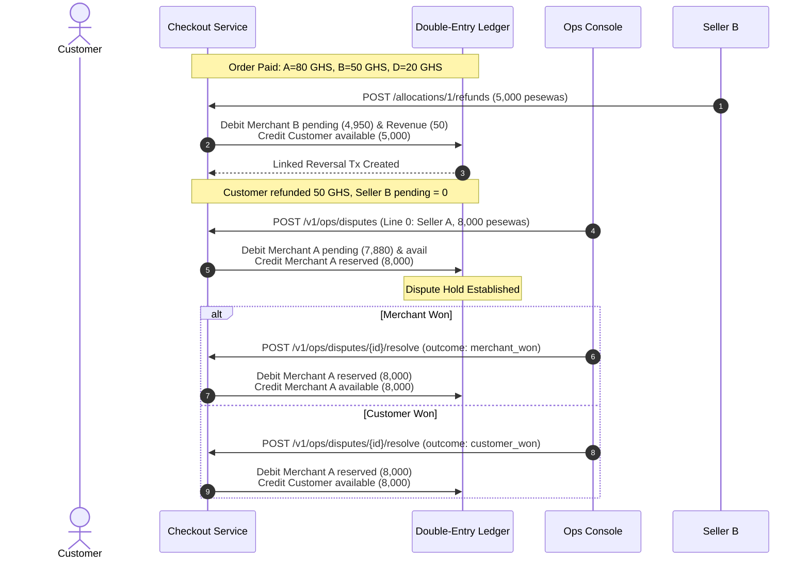
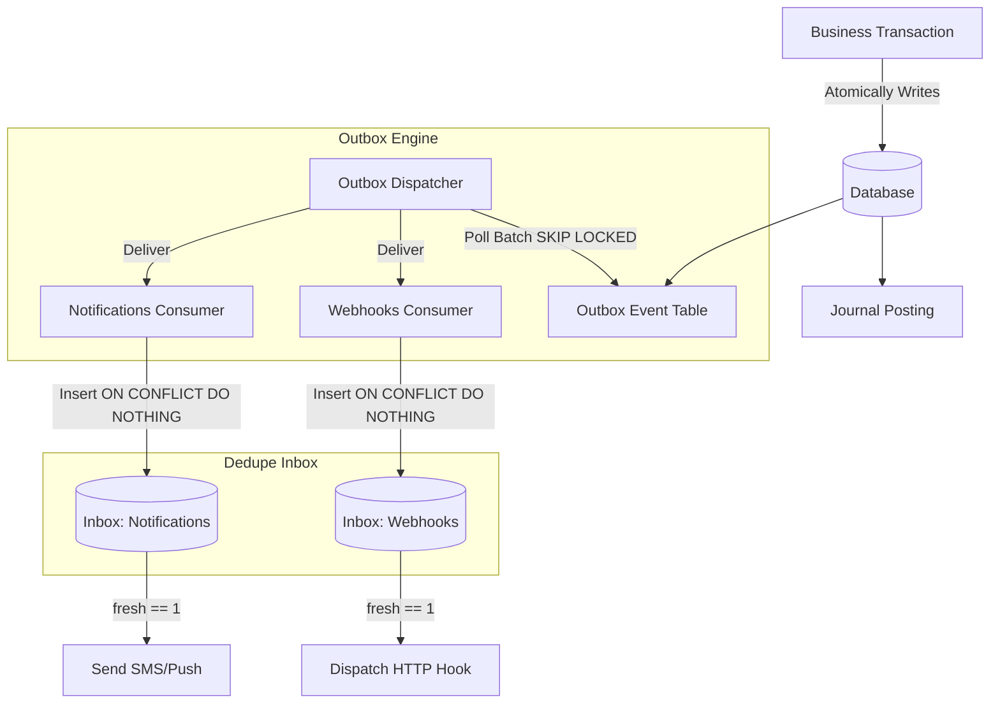
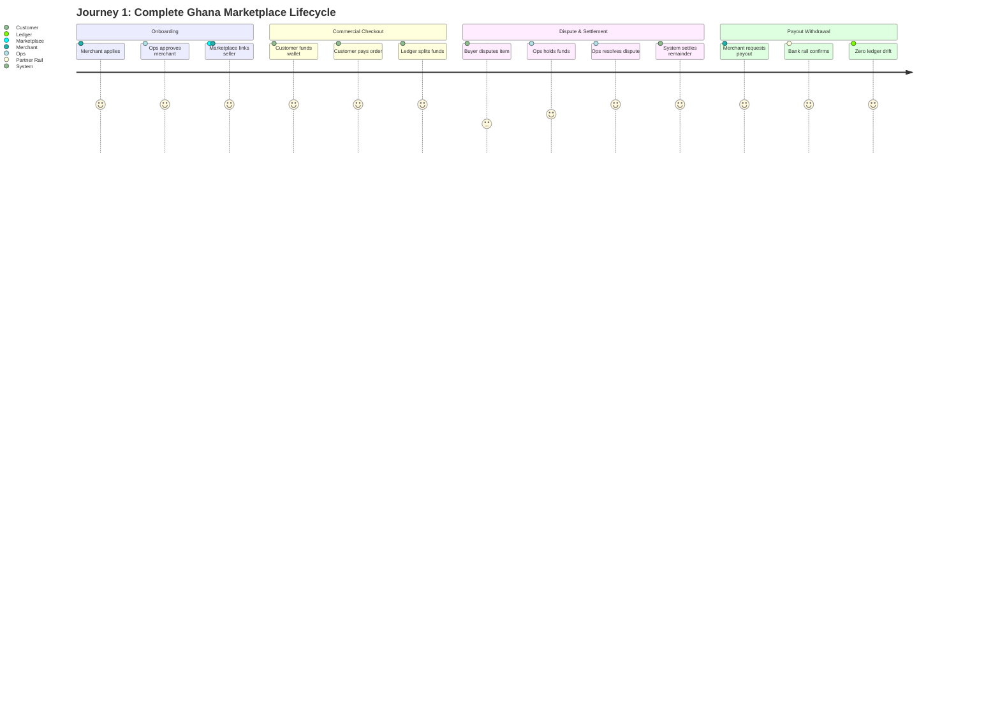
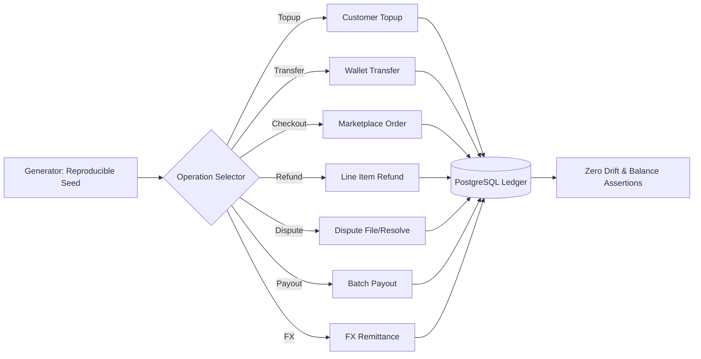

# E2E Testing Track — Explorer 2 Report: Tier 3 & Tier 4 Specifications

**Document:** `/home/antigravity/Elemarket9/ELEPAY-Core/.agents/teamwork/e2e_exp_r1_2/handoff.md`  
**Author:** Technical Explorer 2 (E2E Testing Track)  
**Target:** Sub-Orchestrator (`sub_orch_e2e_testing`)  
**Scope:** Complete Architectural and Operational Specifications for Tier 3 (Cross-Feature Combinations) and Tier 4 (Real-World Application Scenarios) E2E Test Suites.

---

## 1. Executive Summary & Testing Philosophy

Per the authoritative product specifications (`docs/product-specification.md`, `ORIGINAL_REQUEST.md`, and `PROJECT.md`), ELEPAY is a Ghana-first financial platform designed with immutable, double-entry ledger primitives, multi-party commercial checkout allocations, autonomous payouts with rail retry deduplication, locked FX corridors, transactional outbox/inbox messaging, and rigorous compliance controls.

### Opaque-Box Invariant Principles
All tests specified herein are **opaque-box** and interact with ELEPAY Core strictly through its published HTTP interfaces, REST API contracts (`docs/openapi.json`), dev authentication tokens, and simulated partner gateway protocols. No internal private methods or implementation shortcuts are assumed:
1. **Integer Minor Units:** All monetary amounts are integers in pesewas (or minor units of foreign currencies, e.g., cents/pence).
2. **Per-Currency Zero-Sum Balance:** Every posted journal entry must independently net to zero for each currency.
3. **Append-Only Journal:** Balances are derived projections from immutable journal transactions; no direct balance tampering is possible.
4. **Strict Idempotency:** Any financial command requires an `Idempotency-Key`. Replays return identical responses; payload mutations under the same key return HTTP 409 Conflict.
5. **No Negative Available Balances:** Overdrafts and races must fail deterministically at the execution boundary without corrupting state.
6. **State Transitions & Unknown Outcomes:** Timeouts leave transactions in `unknown` state without duplicate charge or payout. Dual-control (maker-checker) protects sensitive operations.

---

## 2. Tier 3: Cross-Feature Combinations (Pairwise & Multi-Module Coverage)

Tier 3 tests verify that disparate modules interact correctly across transactional boundaries, event dispatch loops, and financial ledger legs.

```mermaid
flowchart TD
    subgraph T3_1["Combo 1: Wallet + Limits + Ledger"]
        W1[Customer Wallet] -->|Check Limits| L1[KYC & Velocity Rules]
        L1 -->|Lock Accounts| J1[Double-Entry Ledger]
    end

    subgraph T3_2["Combo 2: Checkout Multi-Split"]
        C2[Customer Payment] -->|Debit 150 GHS| CL2[Checkout Engine]
        CL2 -->|Alloc 80 GHS| MA[Merchant A Pending]
        CL2 -->|Alloc 50 GHS| MB[Merchant B Pending]
        CL2 -->|Alloc 20 GHS| MD[Delivery Pending]
    end

    subgraph T3_3["Combo 3: Refunds & Disputes"]
        RF3[Line Refund] -->|Proportional Fee Reversal| J3[Ledger Reversal]
        DSP3[Dispute Filed] -->|Pending/Avail to Reserved| HD3[Dispute Hold]
        HD3 -->|Resolution| RS3[Merchant/Customer Won]
    end

    subgraph T3_4["Combo 4: Payout Batch & Dedupe"]
        PB4[Batch Payout] -->|Available to Reserved| RV4[Reservation]
        RV4 -->|Rail Dispatch| RL4[Partner Rail]
        RL4 -->|Failure/Return| RT4[Retry-Of Constraint]
    end
```



---

### Combo 1: Ledger + Wallet Transfers + Limit Checks (KYC Tier Limits & Velocity Limits)

#### 1. Description & Module Interactions
Validates the interplay between:
- `com.elepay.ledger`: Account row locking (`ORDER BY id FOR UPDATE`), atomic balance postings.
- `com.elepay.wallet`: `Wallets.send()`, `RecipientConfirmations`, ephemeral single-use tokens.
- `com.elepay.wallet.TransferLimits`: Velocity limits (per-minute transaction count), per-transaction ceilings, and cumulative daily limits calculated against `Africa/Accra` midnight.

#### 2. Test Scenarios & Step-by-Step Flow
1. **Setup & Seeding:**
   - Enroll Sender $S$ (Tier 1 limit, e.g., max 5,000 pesewas per transaction, 10,000 pesewas daily).
   - Enroll Recipient $R_1$ and $R_2$.
   - Fund Sender wallet with 20,000 pesewas via simulated top-up.
2. **Single Transaction Ceiling:**
   - Sender attempts to transfer 6,000 pesewas to $R_1$ via `/v1/wallet/transfers/confirmed`.
   - **Assertion:** Rejection with HTTP 409 Conflict (`code: "transfer_limit"`). Sender balance remains 20,000.
3. **Valid Leg Transfer & Ledger Invariant:**
   - Sender transfers 4,000 pesewas to $R_1$.
   - **Assertion:** HTTP 200 OK. Sender available = 16,000; $R_1$ available = 4,000. Journal transaction has 2 balanced legs netting to zero in GHS.
4. **Velocity Rule Enforcement (Per-Minute Frequency):**
   - Execute $N$ rapid transfers under the per-minute threshold, then trigger $(N+1)$-th transfer within the same 60-second sliding window.
   - **Assertion:** HTTP 429 Too Many Requests (`code: "transfer_rate_limit"`).
5. **Cumulative Daily Ceiling:**
   - Execute additional valid transfers reaching exactly the 10,000 pesewas daily ceiling.
   - Attempt a further 100 pesewas transfer.
   - **Assertion:** HTTP 409 Conflict (`code: "daily_transfer_limit"`).
6. **Concurrent Velocity Assault:**
   - Spawn 10 concurrent threads attempting transfers with distinct valid confirmation tokens.
   - **Assertion:** Row locking on the `customer` row (`FOR UPDATE`) serializes evaluation; daily and velocity limits are enforced atomically without race conditions; ledger balances match transaction logs with zero drift.

---

### Combo 2: Customer Wallet + Commercial Checkout + Multi-Allocation Split

#### 1. Description & Module Interactions
Validates multi-party marketplace purchases funded from an authenticated wallet:
- `com.elepay.checkout`: Checkout creation, allocation table lines, customer fee schedule calculation.
- `com.elepay.merchant`: Marketplace-seller permissions (`marketplace_seller` relationship), merchant fee matrices.
- `com.elepay.ledger`: Single atomic debit from customer available bucket, split into multiple credits: Merchant pending buckets (net of fee) and system revenue bucket (fee sum).

#### 2. Test Scenarios & Step-by-Step Flow
1. **Marketplace & Sellers Setup:**
   - Create Marketplace $M$, Seller $A$ (agreed fee: 1.5% = 150 bps), Seller $B$ (agreed fee: 1.0% = 100 bps), Delivery Partner $D$ (agreed fee: 0 bps).
   - Marketplace links Sellers $A, B$ and Delivery $D$; each accepts via `/v1/merchants/{id}/marketplaces/{mp}/accept`.
2. **Order & Checkout Creation:**
   - Marketplace creates checkout for Order `ELM-COMB-101`:
     - Line 0: Seller $A$ = GH₵80.00 (8,000 pesewas), fee = 120 pesewas $\rightarrow$ net = 7,880.
     - Line 1: Seller $B$ = GH₵50.00 (5,000 pesewas), fee = 50 pesewas $\rightarrow$ net = 4,950.
     - Line 2: Delivery $D$ = GH₵20.00 (2,000 pesewas), fee = 0 pesewas $\rightarrow$ net = 2,000.
     - Subtotal = GH₵150.00 (15,000 pesewas). Customer wallet fee = 0.
3. **Atomic Payment Execution:**
   - Customer funds wallet with 15,000 pesewas.
   - Customer calls `/v1/checkouts/{reference}/pay/wallet` with `Idempotency-Key: KEY-PAY-01`.
   - **Assertion:** HTTP 200 `status: "paid"`.
4. **Ledger Balances Verification:**
   - Customer `available`: $15,000 - 15,000 = 0$.
   - Seller $A$ `pending`: 7,880.
   - Seller $B$ `pending`: 4,950.
   - Delivery $D$ `pending`: 2,000.
   - Platform `system:revenue:GHS`: $+170$ ($120 + 50$).
   - Sum of credits ($7,880 + 4,950 + 2,000 + 170 = 15,000$) exactly matches debit (15,000). Net per currency = 0.
5. **Replay & Repeat Protection:**
   - Replay with identical key $\rightarrow$ identical receipt returned.
   - Call with new key $\rightarrow$ HTTP 409 Conflict.

---

### Combo 3: Checkout + Line-Item Refunds + Ledger Reversals + Dispute Holds

#### 1. Description & Module Interactions
Validates post-payment lifecycle exceptions:
- Proportional merchant fee return on partial or full line refund.
- Ledger posting linking reversal to the original checkout journal entry (`related_to`).
- Operational dispute filing moving funds from merchant `pending`/`available` into `reserved` (dispute hold).
- Dispute resolution directing reserved funds to customer or releasing to merchant.



#### 2. Test Scenarios & Step-by-Step Flow
1. **Initial Paid State:** A three-way order (from Combo 2) is in `paid` status.
2. **Partial Line-Item Refund:**
   - Seller $B$ cancels their portion: calls `POST /v1/merchants/{b}/checkouts/{ref}/allocations/1/refunds` with amount = 2,500 (half).
   - Proportional fee return = $\frac{50 \times 2500}{5000} = 25$ pesewas.
   - Merchant debit = $2500 - 25 = 2475$.
   - **Assertion:** Customer wallet credited 2,500 pesewas. System revenue debited 25 pesewas. Seller $B$ pending reduced to 2,475.
3. **Full Remaining Refund on Line:**
   - Seller $B$ refunds remaining 2,500 pesewas.
   - Remaining fee returned = 25 pesewas.
   - Seller $B$ pending = 0. Customer credited 2,500.
4. **Excessive Refund Rejection:**
   - Attempt to refund 1 additional pesewa on Line 1.
   - **Assertion:** HTTP 409 Conflict (`code: "refund_exceeds_allocation"`).
5. **Dispute Hold (Line 0 - Seller A):**
   - Customer opens chargeback/dispute with Ops: `POST /v1/ops/disputes` with `{checkout: ref, line: 0, amount: 8000, reason: "Defective item"}`.
   - Funds in Seller $A$'s `pending` (7,880) and `available` (120) are moved to Seller $A$'s `reserved` (8,000).
   - **Assertion:** Dispute state = `open`. Hold transaction recorded in ledger.
6. **Dispute Resolution (Customer Won):**
   - Ops resolves: `POST /v1/ops/disputes/{id}/resolve` with `{"outcome": "customer_won"}`.
   - **Assertion:** 8,000 pesewas debited from Seller $A$'s `reserved` and credited directly to customer `available`. Dispute state = `customer_won`. Net ledger drift = 0.

---

### Combo 4: Payout Batching + Float Reservation + Rail Retry Deduplication (`retry_of`)

#### 1. Description & Module Interactions
Validates batch driver/creator payouts from merchant balance to bank/MoMo rails:
- `com.elepay.payout`: Up to 500 items per batch, atomic pre-submission balance reservation (`available` $\rightarrow$ `reserved`), per-item independent lifecycle.
- `com.elepay.rails`: Direct partner submission, handling success, failure, return, and timeout.
- Deduplication rule (`retry_of`): Definitively failed or returned items can be retried exactly once with a linked reference. Succeeded items cannot be retried.

#### 2. Test Scenarios & Step-by-Step Flow
1. **Batch Creation & Pre-Reservation:**
   - Platform balance seeded with GH₵1,000 (100,000 pesewas).
   - Submit batch of 3 payouts (`POST /v1/merchants/{id}/payout-batches`):
     - Item 1 (`drv-ok`): 10,000 pesewas to MTN `0245550005` (valid).
     - Item 2 (`drv-fail`): 20,000 pesewas to Telecel `0205550001` (configured to decline).
     - Item 3 (`drv-ret`): 15,000 pesewas to MTN `0245550006` (succeeds, then returns).
   - Total batch = 45,000 pesewas.
   - **Assertion:** Platform `reserved` = 45,000 pesewas; `available` = 55,000 pesewas.
2. **Rail Processing & Resolution:**
   - Execute rail recovery:
     - `drv-ok`: Rail succeeds $\rightarrow$ 10,000 debited from `reserved`, credited to rail clearing. Status = `succeeded`.
     - `drv-fail`: Rail declines $\rightarrow$ 20,000 debited from `reserved`, returned to platform `available`. Status = `failed`.
     - `drv-ret`: Rail succeeds $\rightarrow$ 15,000 to clearing.
3. **Delayed Return Processing:**
   - Simulated partner signals return on `drv-ret`:
     - Callback with `status: "returned"`.
     - **Assertion:** 15,000 pesewas debited from rail clearing, credited back to platform `available`. Payout status = `returned`. Platform available is now $55,000 + 20,000 + 15,000 = 90,000$.
4. **Retry Enforcement (`retry_of`):**
   - Attempt retry on `drv-ok` $\rightarrow$ Rejection HTTP 409 (`code: "payout_not_retryable"`).
   - Retry failed item `drv-fail` via `POST /v1/merchants/{id}/payouts/{drv-fail}/retry`:
     - **Assertion:** Creates new payout with `retry_of = drv-fail.id`. Status = 200 OK.
   - Attempt second retry on `drv-fail`:
     - **Assertion:** Rejection HTTP 409 (`code: "already_retried"`).
5. **Reconciliation Assertion:** Every completed item matches external clearing; no account is paid twice.

---

### Combo 5: FX Quotes + Locked TTL + Cross-Currency Clearing + Remittance Delivery

#### 1. Description & Module Interactions
Validates cross-border international remittances and FX conversions:
- `com.elepay.fx`: Rate ingestion, tiered margin engine, quote generation with TTL expiration timestamp.
- `com.elepay.ledger`: Cross-currency journal entry balancing independently in both currencies via explicit clearing accounts:
  - Source Leg (GHS): Debit Customer Available GHS, Credit `system:fx_clearing:GHS`.
  - Destination Leg (USD/GBP): Debit `system:fx_clearing:USD`, Credit `system:fx_in_flight:USD`.
- Remittance Delivery: Inbound webhook verification, quote expiration check, out-of-flight clearing release.

#### 2. Test Scenarios & Step-by-Step Flow
1. **Corridor Configuration:**
   - Setup corridor `UK-GH-GBP-GHS-PARTNER-MOMO`:
     - Direction: `inbound`, Source: `GBP`, Destination: `GHS`.
     - Base rate = 19.50, margin = 25 bps, fixed fee = 0, quote TTL = 300 seconds.
2. **Quote Generation:**
   - Request quote for GBP 100.00 (10,000 pence):
     - Quoted rate = 19.4512 GHS/GBP.
     - Destination amount = 194,512 pesewas (GH₵1,945.12).
     - Quoted TTL = 300s, `status: "active"`.
3. **Execution Within TTL:**
   - Execute transfer against active quote before expiration.
   - **Assertion:** Journal posting contains two balanced currency loops:
     - GBP: Net = 0.
     - GHS: Net = 0.
4. **Expired Quote Rejection:**
   - Request quote, fast-forward time beyond TTL (or mock expiry).
   - Attempt execution:
     - **Assertion:** Rejection HTTP 409 Conflict (`code: "quote_expired"`). Customer funds untouched.
5. **Rate Fluctuation Tamper Protection:**
   - Submit transfer request referencing quote $Q_1$, but pass modified destination amount in payload.
   - **Assertion:** Rejection HTTP 422 Unprocessable Entity (`code: "quote_changed"` or hash mismatch).
6. **Inbound Remittance MoMo Delivery:**
   - Partner submits signed inbound webhook with MTCN reference, GBP 100 $\rightarrow$ GHS 1,945.12 to recipient phone `0245550005`.
   - **Assertion:** Signature verified via HMAC; recipient wallet credited 194,512 pesewas; partner clearing debited GBP 100. Duplicate webhook returns HTTP 200 with no secondary credit.

---

### Combo 6: Outbox Event Publishing + Inbox Deduplication Across Multiple Consumers

#### 1. Description & Module Interactions
Validates reliable asynchronous domain event propagation:
- `com.elepay.outbox.Outbox`: Transactional outbox pattern. Inserts `outbox_event` inside the exact same database transaction as the business operation.
- `com.elepay.outbox.OutboxDispatcher`: Background poller with `FOR NO KEY UPDATE SKIP LOCKED` batching.
- Consumers:
  1. `Webhooks`: Merchant webhook dispatcher.
  2. `Notifications`: Customer notification queue.
- `outbox_consumer_inbox`: Deduplication table recording `(consumer, event_id)` uniquely.



#### 2. Test Scenarios & Step-by-Step Flow
1. **Atomic Event Insertion:**
   - Execute wallet payment for Checkout `ELM-OUT-01`.
   - **Assertion:** `checkout.paid` is present in `outbox_event` with `published_at IS NULL`.
2. **Multi-Consumer Dispatch:**
   - Trigger dispatcher batch:
     - Webhook consumer delivers event to merchant endpoint.
     - Notification consumer creates SMS record for customer.
   - **Assertion:** Both consumers execute in independent `REQUIRES_NEW` transactions; `outbox_consumer_inbox` has two rows with `event_id`. `outbox_event.published_at` is updated to timestamp.
3. **Simulated Crash & Re-Delivery (Inbox Deduplication):**
   - Reset `published_at = NULL` on the event (simulating server crash prior to marking event published).
   - Re-run `OutboxDispatcher.dispatchBatch()`:
     - **Assertion:** `INSERT INTO outbox_consumer_inbox ... ON CONFLICT DO NOTHING` returns 0 affected rows.
     - Consumers skip execution (`fresh == 0`). No duplicate webhooks or notifications emitted.
     - `attempts` counter increments to 2.

---

### Combo 7: Maker-Checker Dual Control on Privileged Operations

#### 1. Description & Module Interactions
Enforces non-negotiable security invariant #113 ("Require maker-checker approval for sensitive financial and administrative actions"):
- Privileged operations: Ops Merchant Onboarding Review, Manual Settlement Force-Runs, Suspense Balances Clearance, Dispute Resolutions above financial threshold.
- Dual-Control Rule: Proposer (Maker) $\neq$ Approver (Checker). Single operator cannot approve their own action.

#### 2. Test Scenarios & Step-by-Step Flow
1. **Self-Approval Rejection:**
   - Operator `ops-alice` proposes settlement run with `ignoreDelay = true` or creates privileged adjustment item.
   - `ops-alice` attempts to approve / review the operation.
   - **Assertion:** HTTP 403 Forbidden (`code: "maker_checker_violation"`, message: "Proposer cannot approve own request"). Action remains pending.
2. **Dual-Operator Execution:**
   - Independent operator `ops-bob` (`subject: "ops-bob"`) reviews and approves the pending item.
   - **Assertion:** HTTP 200 OK. Operation executes atomically.
3. **Audit Trail Verification:**
   - Query `/v1/ops/audit` for the subject.
   - **Assertion:** Hash-chained audit entry contains `maker: "ops-alice"`, `checker: "ops-bob"`, action details, and immutable timestamp.

---

## 3. Tier 4: Real-World Application Scenarios (End-to-End User Journeys)

Tier 4 tests model end-to-end user journeys encompassing the entire lifecycle of market actors across multiple days, network states, and financial conditions.



---

### Scenario 1: Complete Ghana Marketplace Lifecycle
*From Onboarding to Multi-Party Settlement, Partial Dispute Resolution, and Bank Withdrawal.*

#### Journey Persona & Entities
- Marketplace: **ELEMARKET** (`mp`)
- Seller 1: **Accra Kicks** (`seller_a`, shoes)
- Seller 2: **Tema Wear** (`seller_b`, apparel)
- Delivery: **ELESEND** (`delivery_d`, rider)
- Shopper: **Kwame Mensah** (`customer_k`)

#### Execution Stages & Verification Steps
1. **Onboarding & Credential Scoping:**
   - `seller_a`, `seller_b`, and `delivery_d` submit applications via `POST /v1/merchants`.
   - Ops reviews and activates with agreed fee tiers:
     - `seller_a`: 150 bps (1.5%), settlement delay = 24h.
     - `seller_b`: 200 bps (2.0%), settlement delay = 24h.
     - `delivery_d`: 0 bps, settlement delay = 0h.
   - `ELEMARKET` invites all three; all three accept. Scoped API keys generated.
2. **Catalog Payment Link & Order Creation:**
   - `ELEMARKET` generates order `ELM-ORDER-999`:
     - Line 0 (`seller_a` shoes): GH₵120.00 (12,000 pesewas). Fee = 180 pesewas $\rightarrow$ Pending = 11,820.
     - Line 1 (`seller_b` shirt): GH₵60.00 (6,000 pesewas). Fee = 120 pesewas $\rightarrow$ Pending = 5,880.
     - Line 2 (`delivery_d` courier): GH₵20.00 (2,000 pesewas). Fee = 0 $\rightarrow$ Pending = 2,000.
     - Order Subtotal = GH₵200.00 (20,000 pesewas).
3. **Customer Checkout Payment:**
   - Kwame Mensah funds wallet with 20,000 pesewas via MTN MoMo simulator.
   - Kwame submits single payment confirmation to `/v1/checkouts/{ref}/pay/wallet`.
   - **Invariants Verified:**
     - Kwame available = 0.
     - `seller_a` pending = 11,820.
     - `seller_b` pending = 5,880.
     - `delivery_d` pending = 2,000.
     - Platform revenue = 300 pesewas.
     - Total funds accounted: $11,820 + 5,880 + 2,000 + 300 = 20,000$ pesewas.
4. **Dispute Filing on Line 1:**
   - Shirt arrives damaged. Kwame files dispute on Line 1 (GH₵60.00).
   - Ops opens dispute: `POST /v1/ops/disputes` (`amount: 6000`, `line: 1`).
   - Line 1 pending reduced to 0; `seller_b` `reserved` credited 6,000 pesewas (5,880 from pending + 120 recovered fee).
5. **Settlement Run (Delayed Window):**
   - Settlement job executes:
     - `delivery_d` (0h delay): GH₵20.00 moves from `pending` to `available`.
     - `seller_a` (24h delay not elapsed): Remains in `pending`.
   - Ops triggers forced run: `POST /v1/ops/settlements/run {"ignoreDelay": true}`.
   - `seller_a`'s 11,820 pesewas moves to `available`.
   - `seller_b` has 0 in pending (due to dispute hold); no settlement batch created.
6. **Dispute Resolution:**
   - Ops rules in customer's favor: `POST /v1/ops/disputes/{id}/resolve {"outcome": "customer_won"}`.
   - 6,000 pesewas moved from `seller_b` `reserved` to Kwame's wallet `available`.
7. **Proceeds Withdrawal to Bank:**
   - `seller_a` adds GCB bank settlement destination and initiates withdrawal for 11,820 pesewas.
   - Rail recovery confirms bank credit.
   - `seller_a` available = 0, reserved = 0.
8. **Final Integrity Assertion:**
   - Query `/v1/ops/ledger/integrity`.
   - **Assertions:** `accountsWithDrift == 0`, `unbalancedTransactions == 0`, `netByCurrency["GHS"] == 0`.

---

### Scenario 2: International Remittance Lifecycle
*UK Sender GBP Quote $\rightarrow$ TTL Lock $\rightarrow$ Cross-Currency Postings $\rightarrow$ Recipient MoMo Payout $\rightarrow$ Float Rebalance Trigger.*

#### Journey Flow & Sequence
1. **Corridor Setup & Treasury Float Baseline:**
   - Corridor `GBP-GHS` active.
   - Float account `system:clearing:momo-mtn:GHS` has initial balance of GH₵50,000.
   - Threshold alert set at GH₵20,000 minimum float.
2. **Sender Quoting:**
   - UK sender requests quote for sending £1,500 (150,000 pence).
   - Rate locked at 1 GBP = 19.40 GHS. Margin = 30 bps.
   - Recipient will receive GH₵29,100 (2,910,000 pesewas).
   - Quote issued with 10-minute TTL.
3. **Funding & Cross-Currency Journal Balancing:**
   - Remittance partner receives GBP deposit, submits inbound execution.
   - Authoritative Journal Transaction posted:
     - **Leg 1 (GBP):** Debit Partner Clearing GBP 1,500; Credit `system:fx_clearing:GBP` 1,500 (Net GBP = 0).
     - **Leg 2 (GHS):** Debit `system:fx_clearing:GHS` 2,910,000; Credit Recipient In-Flight GHS 2,910,000 (Net GHS = 0).
4. **Recipient Mobile Money Delivery:**
   - Payout engine routes GH₵29,100 delivery to MTN MoMo rail.
   - Simulated rail confirms receipt:
     - Debit Recipient In-Flight GHS 2,910,000.
     - Credit MTN MoMo Clearing GHS 2,910,000.
5. **Treasury Float Monitoring & Rebalance Trigger:**
   - MTN float drops from GH₵50,000 to GH₵20,900.
   - Another transfer of GH₵2,000 processes, dropping float to GH₵18,900 (breaching GH₵20,000 floor).
   - **Assertion:** Float monitoring creates an operational alert item in `ops_item` (`kind: "float_rebalance_required"`, rail: "mtn", currentBalance: 18,900).
   - Ops triggers float replenishment from GCB bank treasury account to MTN MoMo float.

---

### Scenario 3: Adverse Network Recovery & Chaos Resilience
*Rail Timeout $\rightarrow$ Unknown Outcome $\rightarrow$ Status Query Recovery $\rightarrow$ Out-of-Order Callbacks $\rightarrow$ Reconciliation.*

#### Chaos Sequence & Resilience Invariants
1. **Submitting Rail Charge with Simulated Timeout:**
   - Customer initiates MoMo checkout for GH₵100 using special test phone `0245550002` (triggers partner HTTP 504 Gateway Timeout).
   - **Assertion:** ELEPAY records rail transaction in `unknown` status. Customer checkout status moves to `processing`. **No funds are debited from the customer, and merchants are not credited.**
2. **Prevention of Duplicate Resubmission:**
   - Customer gets impatient and clicks "Pay Now" again with a new idempotency key.
   - **Assertion:** System detects existing active attempt in flight; returns same attempt reference with `status: "processing"`. No second rail transaction created (`count == 1`).
3. **Status Query Resolution:**
   - Ops rail recovery job runs (`POST /v1/ops/rails/recover`).
   - Rail adapter queries partner status API with the stable ELEPAY reference `EPC...`.
   - Partner responds with `status: "succeeded"`.
   - **Assertion:** Transaction transitions `unknown` $\rightarrow$ `succeeded`. Merchants credited in `pending`. Checkout becomes `paid`.
4. **Out-of-Order & Duplicate Callbacks Attack:**
   - External partner belatedly delivers callbacks:
     - Callback A: `status: "pending"` (stale).
     - Callback B: `status: "succeeded"` (duplicate).
     - Callback C: `status: "failed"` (contradictory).
   - **Assertions:**
     - Stale `pending` ignored under row lock.
     - Duplicate `succeeded` ignored idempotently.
     - Contradictory `failed` does NOT reverse the payment; instead, raises `rail_status_conflict` in `ops_item` for human audit.
5. **Reconciliation Match:**
   - End-of-day statement ingested with the single successful rail reference.
   - Matcher returns 100% exact match; zero drift.

---

### Scenario 4: High-Volume Financial Integrity Stress Suite
*10,000 Multi-Operation Sequence with Strict Mathematical Invariants.*



#### Stress Invariant Specifications (Mandatory CI Gate)
To satisfy the strict requirement in `ORIGINAL_REQUEST.md` (lines 541–547):
- **Scale:** 10,000 generated financial operations per CI run.
- **Reproducibility:** Seeded pseudo-random generator (seed logged at start of run).
- **Concurrent Load:** 16 worker threads executing against shared customer, merchant, and rail pools.

#### Invariant Assertions Evaluated Continuously & Post-Run
1. **Zero Ledger Drift:**
   $$\sum \text{journal\_entry.amount for account } A = \text{ledger\_account.balance for account } A$$
   Asserted for every active account in the database.
2. **Zero Unbalanced Transactions:**
   $$\forall \text{ tx} \in \text{journal\_transaction}, \quad \sum_{e \in \text{legs}(tx, \text{currency})} e.\text{amount} = 0$$
   Asserted across all currencies (`GHS`, `USD`, `GBP`, `EUR`).
3. **No Negative Available Balances:**
   $$\forall c \in \text{customers}, \quad \text{balance}(c, \text{"available"}) \ge 0$$
   $$\forall m \in \text{merchants}, \quad \text{balance}(m, \text{"available"}) \ge 0 \quad \land \quad \text{balance}(m, \text{"reserved"}) \ge 0$$
4. **Idempotency Conservation:**
   Total financial effects $\le$ Total distinct successful business operations. Duplicate requests produce exactly zero ledger postings.

---

## 4. Test Infrastructure Implementation Blueprint

### 4.1 Recommended Test File Organization

```
src/test/java/com/elepay/e2e/
├── tier3/
│   ├── Tier3_1_WalletLimitsLedgerIT.java
│   ├── Tier3_2_MarketplaceSplitIT.java
│   ├── Tier3_3_RefundDisputeReversalIT.java
│   ├── Tier3_4_PayoutBatchRetryIT.java
│   ├── Tier3_5_FxClearingRemittanceIT.java
│   ├── Tier3_6_OutboxInboxMessagingIT.java
│   └── Tier3_7_MakerCheckerSecurityIT.java
└── tier4/
    ├── Tier4_1_GhanaMarketplaceLifecycleIT.java
    ├── Tier4_2_InternationalRemittanceLifecycleIT.java
    ├── Tier4_3_AdverseNetworkRecoveryIT.java
    └── Tier4_4_FinancialIntegrityStressIT.java
```

### 4.2 Base Harness Architecture
- All integration tests extend `com.elepay.PostgresTestBase`.
- Test harness utilizes Spring Boot Random Web Port (`@SpringBootTest(webEnvironment = WebEnvironment.RANDOM_PORT)`).
- Interacts via `TestApi` REST client over HTTP.
- DB assertions made via `JdbcClient` querying PostgreSQL 18 with Flyway schema.
- Uses `SimulatedRail` and `SimulatedFxPartner` for network control.

---

## 5. Summary Traceability Matrix

| Feature / Scenario | Tier | Module Coverage | Key Invariants Verified |
|---|---|---|---|
| Wallet Limits & Velocity | Tier 3 | `ledger`, `wallet` | Per-tx, daily rolling, velocity limits; ordered row lock |
| Marketplace Multi-Split | Tier 3 | `checkout`, `merchant`, `ledger` | Proportional split, merchant fees, zero-sum single debit |
| Line Refunds & Disputes | Tier 3 | `checkout`, `operations`, `ledger` | Proportional fee return, dispute hold reservation, linked reversals |
| Payout Batch & Dedupe | Tier 3 | `payout`, `rails`, `ledger` | Pre-reservation, single retry limit via `retry_of`, independent item outcomes |
| FX Quotes & Corridors | Tier 3 | `fx`, `ledger`, `rails` | Locked TTL quotes, independent currency balancing, in-flight release |
| Outbox & Inbox Dedupe | Tier 3 | `outbox`, `common` | `FOR NO KEY UPDATE SKIP LOCKED`, consumer inbox dedupe on conflict |
| Maker-Checker Dual Control | Tier 3 | `operations`, `identity`, `security` | Single-operator veto, audit trail hashing |
| Ghana Marketplace Lifecycle | Tier 4 | All core modules | Full multi-actor journey from onboarding to bank withdrawal |
| International Remittance | Tier 4 | `fx`, `payout`, `treasury` | Corridor quoting to MoMo payout, float rebalancing trigger |
| Adverse Network Recovery | Tier 4 | `rails`, `checkout`, `operations` | 504 timeout recovery, query by ref, duplicate/stale callback rejection |
| 10k Integrity Stress Suite | Tier 4 | Whole system | 10,000 sequence invariant checks, zero drift, zero unbalanced entries |

---

*Report filed by Technical Explorer 2. Ready for Sub-Orchestrator integration into `TEST_INFRA.md`.*
